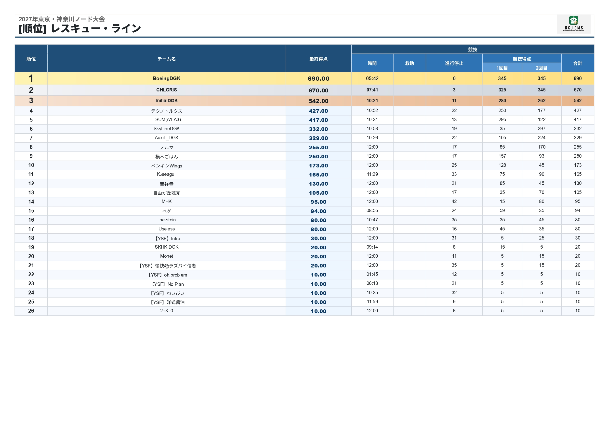

Hello, I'm K10-K10.
We participated in the RoboCup Junior Japan Kanto Block East Tokyo Node Competition RWL on 14 November.

In this post, I'll summarise the results of the competition and our future plans.

# Results

We placed 4th overall.

This year, we are not releasing our program, robot data, or circuit data.

## Run 1

- Score: 250
- Time: 4 min 52 sec
- Lack of Progress: 15

We couldn't detect the entry into the Evacuation Zone, which increased our Lack of Progress calls.
Although we managed to complete the run, our score was limited due to issues such as not being able to climb the slope.

## Run 2

- Score: 177
- Time: 6 min 00 sec
- Lack of Progress: 7

Along the way, we encountered an issue where communication with the ESP was lost, which prevented us from progressing smoothly.
Although we were able to pick up the first survivor, we couldn't detect the survivor near the exit, and thus couldn't rescue them.

We spent too much time on the rescue and were unable to complete the run.

# Overall Results and Reflections

We were able to run on flat ground without any issues.

However, we realised that our robot couldn't climb the slope, so we need to significantly redesign its structure.

Also, the accuracy of the rescue was a challenge, so we aim to build a more reliable algorithm.

# Future Plans

We have received a recommendation to participate in the Kanto Tournament.

We are currently designing a new robot and circuit.
We will improve the program and aim for a perfect run.

Thank you for reading!
