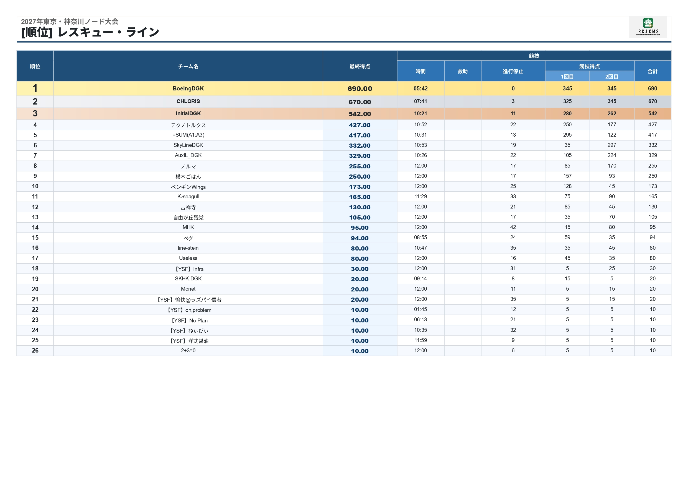

こんにちは、K10-K10です。
11/14にRoboCup Junior Japan 関東ブロック 東東京ノード大会 RWLに参加してきました。

今回は大会の振り返りと今後の予定をまとめます。

# 大会結果

全体4位でした

今年はプログラム、機体データ、回路のデータは公開していません。

## 1走目

- 得点: 250
- タイム: 4分52秒
- 進行停止回数: 15回

被災者救出ゾーンの進入の検知ができず、進行停止回数が増えました。
完走することはできましたが、坂を登れなかったことなどもあり、得点は伸び悩みました。

## 2走目

- 得点: 177
- タイム: 6分00秒
- 進行停止回数: 7回

途中でESPとの通信が切れてしまう問題が発生して、うまく進めませんでした。
また、1つ目の生存者を拾うことはできたものの、出口付近にあった生存者を検出できず、救出できませんでした。

レスキューに時間を割いてしまい、完走できませんでした。

# 全体の結果と反省

平地の走行は問題なくできました。

坂を登ることができないと判明したため、機体の構造を大幅に見直す必要があります。

また、レスキューの精度も課題となったため、より確実なアルゴリズムの構築を目指します。

# 今後の予定

関東大会への推薦をいただけました。

現在新しい機体と回路の設計を行っています。
プログラムを改良し、満点走行を目指します。

Thank you for reading!
